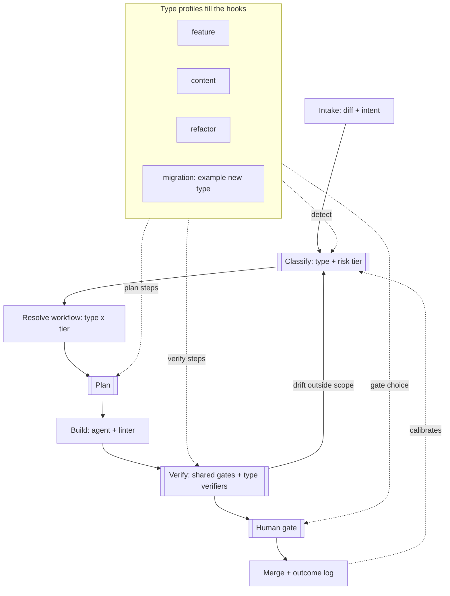

# Change pipeline: one runner, pluggable change types

An orchestrator that looks at a change, decides how risky it is and what kind
of change it is, and runs only the review process that change deserves. A copy
fix gets checked against the CRM and auto-merged. A payments change gets the
full adversarial pipeline and a human signing off on the plan.

New kinds of change plug in as a single YAML profile. The runner doesn't change.

## Problem this solves

Multi-agent review pipelines (planner, skeptic, cold reader, newcomer reader)
catch real bugs, but running all of them on every commit is slow, expensive
and mostly ceremony for low-risk work. Running none of them on high-risk work
is how a webhook race deletes a course a student just paid for.

The fix is to make the amount *and kind* of checking depend on two questions:

- **Blast radius:** how bad is it if this is wrong?
- **Uncertainty:** how likely is it to be wrong?

|                 | Low uncertainty | High uncertainty |
|-----------------|-----------------|------------------|
| **Low radius**  | Copy fix: check against source of truth, ship | New UI widget: plan carefully, review lightly |
| **High radius** | Mechanical rename across 40 files: types, tests and fan-out do the work | Payments, auth, data deletion: everything, plus a human on the plan |

## Architecture

Three layers:

1. **Runner (shared, owned by the platform).** Runs the spine: ordering, the
   risk floor, re-tiering on drift, composing types, outcome logging. It
   executes steps but knows nothing about features or content.
2. **Step library (shared, reusable).** Each step has an id, a kind
   (`deterministic` or `agent`), the hooks it may run at, and an owner. See
   [`config/steps.yaml`](config/steps.yaml).
3. **Type profiles (configuration).** Which library steps a type runs at
   each hook and tier. See [`profiles/`](profiles/).



Double-bordered stages are hooks. Everything else is shared and fixed.

## The rules that make it safe to extend

1. **Deterministic signals set a risk floor.** Paths (payments, auth,
   migrations, public APIs), diff size and domain spread come from
   [`config/risk-map.yaml`](config/risk-map.yaml). A profile or a model's
   judgment can raise the tier, never lower it. Otherwise the cheapest path
   wins every argument.
2. **Shared gates always run.** Lint, typecheck, unit tests and secret scan
   run at every tier. Profiles add verifiers; they can't remove these.
3. **Types compose.** A change can match several types (a feature that ships
   a migration). Their steps are unioned and the strictest gate wins. Files
   no profile claims always bring in the `default` profile.
4. **Re-tier on drift.** After build, the runner re-classifies using the
   files the diff actually touched. A "copy change" that edited a pricing
   constant is no longer a copy change.
5. **Gates come from a fixed menu.** [`config/gates.yaml`](config/gates.yaml)
   defines `auto-merge`, `approve-diff` and `approve-plan-and-diff`, plus a
   minimum per tier. Profiles pick from the menu; they can't invent a looser
   gate.
6. **Everything reports outcomes.** The merge stage logs which steps ran,
   what they flagged, and later whether the change was reverted or caused an
   incident (`OutcomeRecord` in [`runner/src/types.ts`](runner/src/types.ts)).
   That's how you find steps that are theater and tiers that are wrong.

## Tiers

| Tier | Meaning | Minimum gate |
|------|---------|--------------|
| T0 | Content: fidelity to a source of truth, no logic | auto-merge |
| T1 | Contained: one module, easy to revert | approve-diff |
| T2 | Cross-cutting: several modules or a public interface | approve-diff |
| T3 | Irreversible: money, auth, data deletion, external side effects | approve-plan-and-diff |

## Adding a change type

Write one file in `profiles/`. Only `detect` is required; every other hook
inherits from `default` unless you override it.

```yaml
type: migration
extends: default
detect:
  paths: ["db/migrations/**"]
  intents: [migration, schema]
  risk_floor: T2            # can raise the floor, never lower it
plan:
  all: [fan-out-map, skeptic-review]
  T3: [rollback-plan]
verify:
  all: [dry-run-on-clone, rollback-script-check]
gate:
  T2: approve-diff
  T3: approve-plan-and-diff
```

Hook lists are cumulative: at tier T you get `all` plus every tier key at or
below T. A gate lookup takes the highest tier key at or below T, then the
strictest of that and the tier minimum.

If you need a step that doesn't exist yet, add it to `config/steps.yaml`.
Once it's there, any type can use it. That's why the CRM check is a library
step (`source-of-truth-diff`) and not part of the content type: a feature
that adds UI text needs it too.

The runner validates every profile on load. Unknown steps, steps used at a
hook they don't allow, and gates that aren't on the menu all fail loudly.

## Connection to the AC evidence framework

[`../ac-evidence-framework`](../ac-evidence-framework) plugs in as two library
steps: `ac-evidence-map` at the plan hook and `ac-evidence-verify` at the
verify hook. The feature profile turns both on at T2 and up. This covers the
gap in agent-only review: a reader agent can tell you code *looks* right;
an evidence contract makes the build *prove* each acceptance criterion.

## Try it

```bash
cd runner
npm install
npm run validate
npm run examples      # sample changes, see examples/run.sh
npx tsx src/cli.ts plan --files "content/home.copy.json,src/pricing/plans.ts" --intent copy
```

The runner is a resolver today: it turns a change into a workflow (types,
tier with the reasons behind it, plan steps, verify steps, gate). Executing
the steps is the next layer.

## Open questions

- **Path matching is blunt.** `src/**/components/**` claims a refactor of a
  button as a feature too. Options: let intent-claimed types suppress
  path-only matches of lower-risk types, or move feature detection to intent
  only.
- **Uncertainty isn't modeled yet.** The tier captures blast radius. The
  other axis (vague requirements, novel code) should probably change *which*
  plan steps run, not just how many.
- **Who owns the risk map** when this is shared across teams: the platform,
  or each repo with a platform-owned minimum?
- **Calibration loop.** The outcome record is defined but nothing writes or
  reads it yet. Start by logging, then review which steps' findings were
  confirmed after a month of data.
